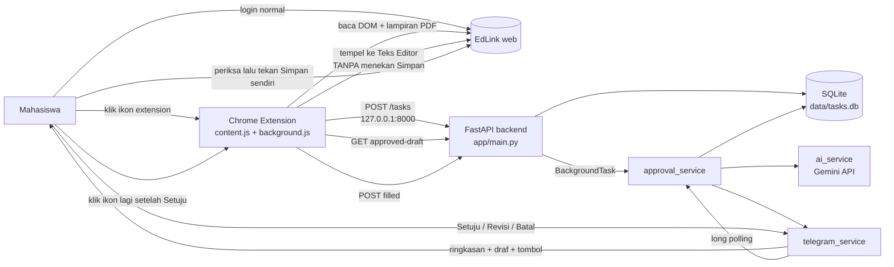

# PROJECT_GUIDE — EdLink AI Agent

> Dokumen orientasi dan referensi teknis. Versi 2, diperbarui 2026-10-16.
> - **Audit awal** dilakukan pada commit `e60a9dc` (branch `main`). Temuan audit itu dicatat di §9 beserta status penyelesaiannya.
> - **Perubahan setelah audit** (perbaikan backend, fitur pengisian Teks Editor, test, README) dikirim sebagai patch dan belum ada di `e60a9dc`. Bagian yang berubah ditandai **[baru]**.
> - Sumber kebenaran adalah **kode dan hasil pengujian**, bukan rencana. Status fitur: **Implemented**, **Partially Implemented**, **Not Implemented**, **Blocked**, **Unverified**, **Broken**.
> - Tidak ada secret yang dibaca atau dicantumkan di dokumen ini.

---

## 1. Project Overview

**Nama:** EdLink AI Agent (backend FastAPI `0.4.0`; extension "EdLink Assistant (dev)" `0.1.0`).

**Masalah:** mahasiswa harus membuka EdLink, membaca instruksi tugas, mengerjakan, lalu menyimpan jawaban secara manual, dan tugas mudah terlewat.

**Tujuan:** mendeteksi tugas di EdLink, menyimpannya tanpa duplikat, membuat draf jawaban dengan AI, meminta persetujuan lewat Telegram, lalu membantu menempelkan draf ke editor jawaban EdLink.

**Prinsip yang dijaga kode:** sistem **tidak pernah menekan Simpan atau Kumpulkan** di EdLink. Draf hanya ditempelkan ke Teks Editor; pengguna memeriksa dan menekan Simpan sendiri. Backend juga tidak punya kode yang menulis ke EdLink.

**Target pengguna:** satu mahasiswa (single-user, satu chat Telegram yang diizinkan, backend lokal).

**Ruang lingkup MVP:** extension Chrome → backend lokal → Gemini → Telegram → (setelah setuju) pengisian Teks Editor oleh extension.

**Di luar cakupan saat ini:** multi-user, OCR untuk PDF hasil scan, lampiran non-PDF, jawaban berupa file (opsi "Tambahkan File" di EdLink), pengumpulan otomatis, WhatsApp, deteksi otomatis dari daftar "Perlu Dikerjakan".

---

## 2. Product Workflow

| # | Langkah | Status | Catatan / bukti |
|---|---------|--------|-----------------|
| 1 | Pengguna login ke EdLink secara normal | Implemented (di luar sistem) | Extension hanya berjalan di `https://edlink.id/panel/classes/*` dan memakai sesi browser pengguna. |
| 2 | Deteksi tugas | Partially Implemented | Manual: klik ikon extension di halaman detail tugas. **Terbukti di EdLink asli** (log console pemilik proyek, 2026-10-16): tugas `TK#1_SysAdmin1` terbaca, tombol "Unduh" tanpa tautan langsung berhasil ditangkap lewat klik (408 KB), backend membaca 1 halaman / 552 karakter. Di halaman daftar `edlink.id/classes` extension memang tidak berjalan (`Tugas tidak ditemukan di halaman ini`). Halaman daftar "Perlu Dikerjakan" (`edlink.id/classes`) tidak dipindai. |
| 3 | Validasi & simpan | Implemented, diuji | `POST /tasks`, tabel `tasks`. |
| 4 | Deteksi duplikasi | Implemented, diuji | `source_key` SHA-256 + `UNIQUE`; tabrakan bersamaan ditangani. |
| 5 | Draf AI | Implemented kode; **Unverified** ke Gemini asli | Diuji dengan pengganti. |
| 6 | Notifikasi Telegram | Implemented kode; **Unverified** ke Telegram asli | Termasuk peringatan "tugas kelompok" **[baru]**. |
| 7 | Setuju / Revisi / Batal | Implemented, diuji (mock) | State machine terkunci per status **[baru]**. |
| 8 | Pengisian jawaban ke Teks Editor **[baru]** | Implemented, diuji pada halaman **tiruan**; **Unverified** di EdLink asli | `content.js` `fillEditor`, `background.js` `fillApprovedDraft`. Tidak menekan Simpan. |
| 9 | Pengumpulan / Simpan di EdLink | **Tidak otomatis, sengaja** | Dilakukan pengguna di halaman EdLink. |
| 10 | Pembaruan status | Implemented, diuji **[baru]** | `detected → draft_ready → approved → filled`, atau `cancelled`. |

---

## 3. Technology Stack

| Teknologi | Peran | Versi |
|-----------|-------|-------|
| Python | Runtime backend | minimum 3.10 (`X \| None`), diuji 3.13.16 |
| FastAPI | REST API | 0.143.2 (dipin **[baru]**) |
| Uvicorn (`[standard]`) | Server ASGI | 0.54.0 (dipin) |
| httpx | Klien HTTP ke Gemini dan Telegram | 0.28.1 (dipin) |
| python-dotenv | Memuat `backend/.env` | 1.2.4 (dipin) |
| pypdf | Ekstraksi teks PDF | 6.20.1 (dipin) |
| pytest | Test backend (dev) **[baru]** | tidak dipin |
| SQLite (stdlib) | Penyimpanan `data/tasks.db` | bawaan Python |
| Gemini Interactions API (`.../v1beta/interactions`) | Generasi draf | layanan eksternal; format respons **Unverified** |
| Telegram Bot API (long polling) | Notifikasi & persetujuan | layanan eksternal |
| Chrome Extension Manifest V3 | Pengambilan data & pengisian editor | permission `scripting`, `storage` **[baru]** |
| Playwright + Chromium | Hanya untuk test extension (dev) **[baru]** | opsional |

Tidak ada: ORM, migration tool, Dockerfile, CI, linter. `google-genai` tidak lagi dibutuhkan: `list_models.py` ditulis ulang memakai httpx **[baru]**.

---

## 4. Architecture



**Alur tugas baru:** klik ikon → `content.js` ekstrak judul/batas/deskripsi/lampiran → `POST /tasks` → backend dedup dan simpan → `BackgroundTasks` menjalankan `notify_new_task` → Telegram menerima ringkasan lalu draf bertombol.

**Alur pengisian [baru]:** setelah **Setuju**, pengguna klik ikon lagi di halaman tugas → `POST /tasks` mengembalikan `status: approved` → extension `GET /tasks/{id}/approved-draft` → `content.js` membuka "Tambahkan Jawaban" → "Teks Editor" → menempelkan draf → `POST /tasks/{id}/filled` → Telegram memberi tahu agar pengguna memeriksa dan menekan Simpan.

**Batas tanggung jawab modul**

| Modul | Tanggung jawab |
|-------|----------------|
| `extension/content.js` | Scraping DOM, unduh lampiran, **isi Teks Editor** |
| `extension/background.js` | Orkestrasi, tangkap unduhan berbasis klik, panggilan API (dengan token opsional), badge |
| `app/main.py` | Endpoint, validasi, dedup, token API, lifespan |
| `app/task_service.py` | Akses data, konstanta status, transisi atomik |
| `app/approval_service.py` | State machine persetujuan, notifikasi |
| `app/telegram_service.py` | Klien Telegram, polling, filter chat ID |
| `app/ai_service.py` | Prompt, retry, fallback model |
| `app/attachment_service.py` | PDF → teks |
| `app/database.py` | Koneksi (commit/rollback/close otomatis) dan skema |

**Masih rencana / kosong:** `app/whatsapp_service.py`, `app/edlink_service.py`, `app/models.py`, `extension/popup.html` (file 0 byte, tidak dipakai).

---

## 5. Repository Structure

```
README.md                    cara pakai dan setup  [baru: sebelumnya kosong]
PROJECT_GUIDE.md             dokumen ini
backend/
  requirements.txt           dependency (dipin)
  requirements-dev.txt       + pytest  [baru]
  pytest.ini                 [baru]
  .env.example               template env sesuai kode  [diperbaiki]
  list_models.py             daftar model Gemini (httpx)
  app/
    main.py                  entry point FastAPI, 6 endpoint
    database.py              koneksi + skema + migrasi kolom
    task_service.py          data tugas, status, transisi
    approval_service.py      notifikasi → draf → persetujuan
    telegram_service.py      klien + polling + otorisasi chat
    ai_service.py            Gemini
    attachment_service.py    ekstraksi PDF
    whatsapp_service.py      KOSONG
    edlink_service.py        KOSONG
    models.py                KOSONG
  tests/                     52 test  [baru]
extension/
  manifest.json              MV3
  content.js                 scraping + isi editor
  background.js              orkestrasi
  popup.html                 KOSONG
  test/                      test extension (Playwright + stub chrome)  [baru]
data/                        .gitkeep; tasks.db dibuat saat runtime
```

---

## 6. Database and Data Flow

SQLite `data/tasks.db` (dapat diganti dengan `EDLINK_DB_PATH`). Skema dibuat `init_db()`; kolom baru lewat `_ensure_column`.

**Tabel `tasks`:** `id` PK AUTOINCREMENT · `source_key` TEXT NOT NULL **UNIQUE** · `title` · `description` · `due_text` (teks mentah) · `url` (tanpa query/fragment) · `status` (default `detected`, tanpa CHECK) · `draft` · `created_at` · `attachment_text` · `attachment_info`.

**Tabel `bot_state`:** `key` PK, `value`. Satu kunci dipakai: `awaiting_revision`.

Tidak ada foreign key, `updated_at`, atau riwayat draf.

**Deduplikasi:** `sha256(f"{url_tanpa_query}|{judul.strip().casefold()}")`. Diuji: duplikat persis, beda huruf/spasi, beda query. Judul berubah = tugas baru. Tabrakan `UNIQUE` pada request bersamaan kini dianggap duplikat, bukan error 500 **[baru, diuji]**.

**Status tugas [diperbarui]:**

```
detected ──(draf dibuat)──► draft_ready ──(Setuju)──► approved ──(extension: draf ditempel)──► filled
    │                          │  ▲
    │                          │  └─(Revisi → draf baru)
    └────────(Batal)──────────┴──(Batal)──► cancelled
```

Aturan yang ditegakkan kode dan test: `approved`, `filled`, `cancelled` **tidak dapat ditimpa** oleh pembuatan draf (endpoint `/draft` → 409; `save_draft` bersyarat; Telegram menolak aksi). `approve` memakai transisi atomik `draft_ready → approved`. `filled` hanya dari `approved`.

**Risiko data yang tersisa:** status tidak dibatasi CHECK di level SQL (hanya kode aplikasi); `awaiting_revision` global (§9 M-4).

---

## 7. API Reference

Semua endpoint **kecuali `/health`** meminta header `X-API-Token` **jika** `EDLINK_API_TOKEN` diisi **[baru]**; bila kosong, tidak ada autentikasi (backend mencatat peringatan saat start). Dokumentasi interaktif: `/docs`.

| Method & path | Fungsi | Status code | Verifikasi |
|---------------|--------|-------------|------------|
| `GET /health` | Cek hidup | 200 | Test ✔, server nyata ✔ |
| `POST /tasks` | Simpan tugas + dedup + picu notifikasi/draf. Respons kini memuat `status` tugas **[baru]** | 200; 401; 422 | Test ✔ |
| `GET /tasks` | Daftar tugas (tanpa `draft`/`attachment_text`) | 200; 401 | Test ✔ |
| `POST /tasks/{id}/draft` | Draf AI manual. Ditolak bila status `approved`/`filled`/`cancelled` **[baru]** | 200; 404; **409**; 429; 502; 401 | Test ✔ (Gemini dengan mock) |
| `GET /tasks/{id}/approved-draft` **[baru]** | Draf yang sudah disetujui, untuk extension | 200; 404; 409 (belum disetujui / kosong); 401 | Test ✔, server nyata ✔ |
| `POST /tasks/{id}/filled` **[baru]** | Extension melapor draf sudah ditempel; kirim notifikasi Telegram. Idempoten | 200; 404; 409 (bukan `approved`); 401 | Test ✔, server nyata ✔ |

Request `POST /tasks`: `title` (1–300), `description` (≤12000), `due_text` (≤300), `url` (HttpUrl), `attachments` (≤5; `name`≤300, `content_base64`≤21 juta karakter). URL tidak dibatasi ke `edlink.id` (diuji).

---

## 8. Feature Status and Audit Results

| Fitur | Status | Bukti | Hasil verifikasi | Kekurangan |
|-------|--------|-------|------------------|------------|
| Backend & API | Implemented | `main.py` | pytest 52 lulus; server nyata dijalankan dengan token | — |
| Penyimpanan DB | Implemented | `database.py`, `task_service.py` | Diuji; koneksi tertutup (test gagal bila bocor) | Tanpa CHECK status |
| Pengambilan data EdLink | Implemented, **terbukti di EdLink asli** untuk tugas kelompok berlampiran PDF | `content.js`, `background.js` `captureByClick` | Log console pemilik: tugas terbaca, PDF 408 KB tertangkap, 552 karakter terbaca, `POST /tasks` 200 | Baru satu jenis halaman yang dicoba (tugas kelompok); tugas individu/tanpa lampiran belum; manual via klik |
| Deduplikasi | Implemented | `main.create_task` | Diuji termasuk tabrakan bersamaan | Judul berubah = tugas baru |
| Draf AI | Implemented, **terbukti di Gemini asli** | `ai_service.py` | Log pemilik: `status=200`, draf 2293 karakter dari isi PDF tiba di Telegram dan editor | Kualitas isi tergantung model; prompt diperketat agar tanpa kalimat pembuka/catatan (N-3) |
| Lampiran PDF | Implemented (teks) | `attachment_service.py` | Teks, scan, rusak, non-PDF, >3 file diuji | Tanpa OCR |
| Telegram | Implemented kode / Unverified | `telegram_service.py` | Otorisasi chat diuji (mock) | Belum dicoba ke Telegram asli |
| Persetujuan pengguna | Implemented | `approval_service.py` | Diuji, termasuk balapan "disetujui saat draf dibuat" | `awaiting_revision` global |
| Pengisian jawaban **[baru]** | Implemented, **terbukti terisi di EdLink asli**; hasil Simpan belum diuji | `content.js` `fillEditor` | Uji nyata 2026-10-18: modal terbuka sendiri, draf 2293 karakter masuk ke Teks Editor, `approved-draft` 200, `filled` 200, Telegram memberi tahu. Plus 11 pemeriksaan di halaman tiruan | Belum dipastikan bahwa Simpan menyimpan teks yang ditempel (state editor); ikon peringatan di editor belum dipahami |
| Alur extension → backend **[baru]** | Implemented, diuji dengan `chrome` palsu | `background.js` | 10 pemeriksaan lulus (badge, token, urutan panggilan, kegagalan) | Belum diuji di Chrome sungguhan |
| Pengumpulan tugas | **Tidak otomatis (sengaja)** | — | Test memastikan "Simpan" dan "Tambahkan File" tidak ditekan | Pengguna menekan Simpan sendiri |
| Pembaruan status | Implemented | `task_service.transition` | Diuji | — |
| Logging & error | Implemented | modul `logging`, `LOG_LEVEL` **[baru]** | Pesan error ke Telegram tidak membocorkan detail (test) | Tanpa rotasi file |
| Security | Partially Implemented | token opsional, allowlist chat | Diuji | Token default mati (§10) |
| Automated tests | Implemented **[baru]** | `backend/tests`, `extension/test` | 52 + 11 + 10 lulus | Tidak ada CI |
| Integrasi end-to-end nyata | **Terbukti sampai penempelan ke editor** (2026-10-18) | — | Rantai: klik ikon → Gemini → Telegram → Setuju → klik ikon → editor terisi → `filled`. Semua langkah muncul di log backend | Langkah Simpan oleh pengguna dan tampilan jawaban setelah disimpan belum diverifikasi |
| WhatsApp | Not Implemented | file kosong | — | — |

---

## 9. Bugs, Risks, and Technical Debt

**Status temuan audit awal (commit `e60a9dc`):**

| ID | Temuan | Status sekarang |
|----|--------|-----------------|
| H-1 | `/draft` menimpa `approved`/`cancelled` | **Diperbaiki**, dijaga test (409 + `save_draft` bersyarat + transisi atomik) |
| H-2 | API tanpa autentikasi | **Dimitigasi**: token opsional `EDLINK_API_TOKEN`. Bila tidak diisi, tetap terbuka (backend memberi peringatan). Sisa risiko di bawah. |
| M-1 | `.env.example` tidak sesuai kode | **Diperbaiki** |
| M-2 | Format respons Gemini belum terverifikasi | **Terbukti** (2026-10-18): model `gemini-3.1-flash-lite` mengembalikan draf yang terbaca, status 200 dalam 7,3 detik |
| M-3 | Koneksi SQLite tidak ditutup | **Diperbaiki**, test gagal bila ada `ResourceWarning` |
| M-4 | Satu state revisi global | **Masih terbuka** |
| M-5 | Dedup rawan `IntegrityError` | **Diperbaiki**, dijaga test |
| M-6 | Selector EdLink belum diverifikasi | **Terbukti** pada satu tugas kelompok berlampiran PDF; jenis halaman lain belum dicoba |
| M-7 | Tanpa test, README kosong | **Diperbaiki** |
| L-1, L-2 | `print` dan `on_event` | **Diperbaiki** (`logging`, `lifespan`) |
| L-3 | Dependency tidak dipin / `google-genai` hilang | **Diperbaiki** |
| L-4 | Error mentah dikirim ke Telegram | **Diperbaiki** (hanya nama tipe error) |
| L-5 | File kosong menyesatkan | **Terbuka**, disebut di README |
| L-6 | `due_text` hanya teks | **Terbuka** |
| L-8 | Dua polling saat `--reload` | **Terbuka**, didokumentasikan |

**Temuan dari uji nyata pertama (2026-10-16)**

- **N-1 (diperbaiki, diuji): draf basi.** Tugas yang tidak punya deskripsi dan lampirannya baru terbaca setelah draf pertama dibuat tetap memakai draf lama (Gemini hanya menjawab "Silakan lampirkan instruksi tugas"). Kini, bila lampiran baru terbaca saat status `detected` atau `draft_ready`, draf dibuat ulang dan dikirim dengan tombol; tugas `approved`/`filled`/`cancelled` tidak disentuh.
- **N-3 (diperbaiki lewat prompt, belum diuji ke Gemini): draf berisi kalimat pembuka dan catatan.** Draf pertama memuat "Berikut adalah draf jawaban...", "Catatan untuk Mahasiswa", dan "Draf ini perlu Anda tinjau..." yang ikut tertempel ke editor. Prompt kini meminta hanya isi jawaban. Pengguna tetap harus membaca dan membersihkan hasilnya.
- **N-2 (diperbaiki, diuji): draf manual tanpa tombol.** `POST /tasks/{id}/draft` hanya mengembalikan draf; tidak ada tombol Setuju di Telegram, sehingga draf tidak bisa disetujui. Kini draf juga dikirim ke Telegram bertombol (hanya untuk status `draft_ready`).
- Tombol Telegram dihapus setelah ditekan. Bila pengguna menekan Revisi lalu `/batal`, draf lama tetap `draft_ready` tanpa tombol; jalan keluarnya `POST /tasks/{id}/draft` (draf baru + tombol).

**Risiko dan utang yang tersisa**

- **Medium — hasil Simpan belum diverifikasi.** Penempelan ke Teks Editor terbukti di EdLink asli (teks tampil dengan paragraf). Yang belum diketahui: apakah state internal editor ikut berubah sehingga Simpan menyimpan teks itu. Mitigasi: pengguna memeriksa editor dan jawaban setelah Simpan. Cara memastikan: checklist §11, langkah 7–8.
- **Medium — ikon peringatan di editor.** Setelah penempelan, pojok kanan bawah editor menampilkan ikon segitiga peringatan (sebelumnya ikon robot hijau). Artinya belum diketahui (arahkan kursor untuk membaca). Bisa berupa validasi atau indikator konten dari EdLink; periksa sebelum menekan Simpan.
- **Medium — arti tombol "Simpan".** Screenshot hanya menunjukkan "Batal" dan "Simpan" di modal Teks Editor. Belum diketahui apakah Simpan sudah menyerahkan jawaban atau hanya menyimpan draf dan masih ada langkah "Kumpulkan". Karena Simpan selalu ditekan pengguna, ini tidak berbahaya, tetapi pesan Telegram sengaja tidak menyebut "dikumpulkan".
- **Medium — M-2 dan M-4** di atas.
- **Medium — tugas kelompok.** Tugas dengan URL `/groupteams/` adalah jawaban kelompok yang terlihat anggota lain. Telegram memberi peringatan. Isi draf tetap tanggung jawab pengguna.
- **Low — token di extension** disimpan polos di `chrome.storage.local`. Cukup untuk pengguna tunggal di mesin sendiri; bukan rahasia tingkat tinggi.
- **Low — setiap klik ikon** extension mengunduh ulang lampiran lewat tombol "Unduh" (menimpa sementara `fetch`/XHR halaman). Rapuh bila EdLink berubah.
- **Low — Gemini:** prompt injection lewat isi tugas/PDF hanya memengaruhi teks draf yang ditinjau pengguna; tidak ada aksi otomatis yang bisa dipicu.

---

## 10. Security and Privacy

| Area | Temuan |
|------|--------|
| Secret & `.env` | `.env` dan `*.db` di `.gitignore`. Pemindaian pola kunci/token pada riwayat git yang terlihat saat audit awal: 0 kecocokan; `.env`/`*.db` tidak pernah dilacak. `.env.example` hanya berisi nama variabel kosong. |
| Kunci Gemini | Header `x-goog-api-key`, bukan URL. |
| Token Telegram | Di URL (standar Telegram); logger `httpx` ditahan di WARNING agar tidak tercetak, dan root logging memakai INFO sehingga ini tetap penting. |
| Autentikasi API | **Token opsional.** Bila `EDLINK_API_TOKEN` diisi: semua `/tasks*` butuh `X-API-Token` (dibandingkan dengan `hmac.compare_digest`; diuji 401 untuk semua endpoint). Bila kosong: terbuka untuk proses lokal mana pun, jadi tetap bind ke `127.0.0.1`. Saran: isi token. |
| Otorisasi Telegram | Chat selain `TELEGRAM_ALLOWED_CHAT_ID` diabaikan; tanpa ID hanya `/start` yang dibalas. Diuji. |
| Credential EdLink | Tidak disimpan. Extension memakai sesi browser pengguna. |
| Persetujuan sebelum aksi | Tombol Setuju/Revisi/Batal; tombol dihapus setelah ditekan; transisi atomik; **tidak ada kode yang menekan Simpan/Kumpulkan** (diuji pada halaman tiruan). |
| Lampiran | Hanya teks PDF yang disimpan; batas ukuran/jumlah/halaman. `pypdf` memproses input tak tepercaya: jaga versi tetap baru. |
| Log | Isi tugas tidak dicatat; nama lampiran dan status dicatat. |
| SQL | Semua query berparameter; satu f-string untuk daftar status konstan internal dan `PRAGMA` dengan nama tabel konstan. |
| Extension | `captureByClick` berjalan di `world: MAIN` dan menimpa sementara API halaman; diakui invasif dan rapuh. Permission `storage` ditambahkan untuk token. |

Jangan menambah fitur yang menyalin sesi/cookie, menyamar sebagai pengguna, memakai endpoint privat EdLink tanpa izin, atau menekan tombol serah/kumpul otomatis.

---

## 11. Setup and Runbook

Ringkas (lengkap di `README.md`). Yang ditandai ✔ sudah dijalankan; ⚠ belum.

```bash
cd backend
python3 -m venv .venv && source .venv/bin/activate     # ✔
pip install -r requirements.txt                         # ✔
cp .env.example .env                                     # lalu isi; ⚠ dengan kunci nyata
uvicorn app.main:app --host 127.0.0.1 --port 8000       # ✔ (tanpa kunci: Telegram/AI nonaktif, server tetap naik)
curl http://127.0.0.1:8000/health                        # ✔
```

**Test**
```bash
cd backend && pip install -r requirements-dev.txt && python -m pytest -q      # ✔ 52 lulus
NODE_PATH=<lokasi node_modules berisi playwright> node extension/test/fill_editor.test.cjs   # ✔ 11 lulus (halaman tiruan)
node extension/test/background.test.cjs                                        # ✔ 10 lulus (chrome palsu)
```

**Pasang extension:** `chrome://extensions` → Developer mode → Load unpacked → folder `extension/`. Bila memakai token: di Console *service worker* extension jalankan `chrome.storage.local.set({ apiToken: "..." })`. ⚠ belum diuji di Chrome sungguhan.

**Checklist uji pertama pada layanan nyata (⚠ dilakukan pemilik proyek)**

1. `python list_models.py`, pilih `GEMINI_MODEL`, isi `.env`. Isi `TELEGRAM_BOT_TOKEN`, jalankan backend, kirim `/start` ke bot, isi `TELEGRAM_ALLOWED_CHAT_ID`, restart.
2. Buka satu tugas di EdLink (mis. yang berlampiran PDF), klik ikon extension. Harapan: badge `OK`; Telegram menerima ringkasan.
3. Periksa log backend: apakah draf berhasil dibuat? Bila "Gemini tidak menghasilkan teks jawaban", format respons Gemini perlu disesuaikan (M-2).
4. Periksa draf di Telegram; coba **Revisi** sekali.
5. Tekan **Setuju**.
6. Kembali ke halaman tugas di EdLink, klik ikon lagi. Harapan: modal "Tambahkan Jawaban" → "Teks Editor" terbuka sendiri dan draf muncul; badge `FILL`.
7. **Periksa isi editor dengan mata.** Ketik satu spasi lalu hapus, atau klik di dalam editor, untuk memastikan editor menganggap teksnya miliknya. Bila editor tampak terisi tetapi tombol Simpan tidak aktif atau hasilnya kosong, catat dan laporkan: fungsi `fillEditor` perlu disesuaikan.
8. Tekan **Simpan** sendiri bila sudah sesuai; periksa jawaban di halaman tugas.

**Masalah umum**

| Gejala | Kemungkinan penyebab |
|--------|---------------------|
| Tidak ada notifikasi Telegram | Token atau chat ID kosong (log: "Telegram belum dikonfigurasi lengkap") |
| `/draft` 502 | Kunci/model Gemini kosong atau respons tak terbaca |
| `/draft` 409 | Tugas sudah `approved`/`filled`/`cancelled` (sengaja) |
| Badge `WAIT` | Tugas belum disetujui di Telegram |
| Badge `ERR` setelah Setuju | Lihat Console service worker: "Gagal mengisi editor: ..." memuat alasan (tombol tak ditemukan, editor sudah berisi teks, dst.) |
| 401 dari backend | `EDLINK_API_TOKEN` diisi tetapi extension belum menyimpan token yang sama |
| Error 409 di log polling | Dua proses backend (jangan pakai `--reload`) |

---

## 12. Current Project State

- **Kode lengkap untuk seluruh alur MVP:** deteksi → simpan → dedup → draf → Telegram → setuju/revisi/batal → pengisian Teks Editor → status `filled`.
- **Terbukti lewat pengujian lokal (tanpa layanan eksternal):** semua endpoint, dedup, lampiran, state machine, otorisasi chat, token API, penutupan koneksi, alur `background.js`, dan logika `fillEditor` pada halaman tiruan. Server nyata dijalankan dengan token dan alur `approved → filled` lewat HTTP.
- **Terbukti di layanan nyata (2026-10-18):** seluruh rantai sampai penempelan ke editor: extension di Chrome, scraping tugas kelompok berlampiran PDF, penangkapan PDF, backend lokal, Gemini (`gemini-3.1-flash-lite`), Telegram (draf bertombol, Setuju, notifikasi `filled`), dan pengisian Teks Editor EdLink.
- **Belum terbukti:** hasil menekan Simpan oleh pengguna (apakah teks yang ditempel tersimpan di EdLink), arti ikon peringatan di editor, tugas individu atau tanpa lampiran, dan Revisi dengan Gemini asli.
- **Bukan MVP-blocker tetapi terbuka:** M-4, deteksi otomatis dari "Perlu Dikerjakan", parse tenggat, OCR, CI.
- **Apakah MVP bisa dipakai end-to-end?** Secara kode ya. Secara bukti belum: satu kali uji nyata (checklist §11) yang menentukan. Kegagalan yang paling mungkin ada di tiga tempat: format respons Gemini, selector judul/lampiran EdLink, dan cara editor EdLink menerima teks.
- **Perubahan ini belum ada di commit `e60a9dc`;** dikirim sebagai patch. Repo di lingkungan kerja ini hanya akses baca, jadi push dilakukan oleh pemilik repo.

---

## 13. Recommended Next Steps

**P0 — terapkan dan buktikan**
1. Terapkan patch, jalankan test, lalu lakukan uji nyata §11. Kriteria selesai: satu tugas melewati langkah 1–8 tanpa perbaikan kode, atau daftar kegagalan konkret tercatat.

**P1 — sesuaikan dengan kenyataan**
2. Perbaiki `fillEditor`/selector sesuai hasil uji nyata (`extension/content.js`; tambahkan kasus ke `extension/test/fill_editor.test.cjs` dari HTML asli yang gagal).
3. Verifikasi dan sesuaikan parser respons Gemini (`ai_service.py`), tambahkan test dari respons nyata yang sudah disamarkan.
4. Isi `EDLINK_API_TOKEN` sebagai kebiasaan; pertimbangkan membuatnya wajib.

**P2 — keandalan**
5. M-4: simpan state revisi per chat/tugas.
6. Deteksi tugas dari daftar "Perlu Dikerjakan" (`edlink.id/classes`): perlu izin host baru di `manifest.json` dan keputusan apakah pemindaian otomatis diinginkan.
7. Parse `due_text` menjadi tanggal dan kirim pengingat.
8. CI sederhana untuk pytest dan test extension.

**P3 — fitur lanjutan**
9. Jawaban berupa file ("Tambahkan File") bila diperlukan.
10. OCR untuk PDF scan.
11. Dukungan lampiran DOCX.

---

## 14. Developer Handover

**Baca dulu:** `README.md` → `backend/app/main.py` → `approval_service.py` (docstring status) → `extension/content.js` (`extractTask`, `fillEditor`) → `extension/background.js` (`action.onClicked`).

**Menjalankan:** `README.md`. Mulai tanpa kunci untuk memastikan server naik, aktifkan layanan satu per satu.

**Memahami alur:** `POST /tasks` → `notify_new_task` → `start_draft` → Telegram → `handle_callback` → `transition(...)` → extension `approved-draft` → `fillEditor` → `/filled`.

**Aman dikembangkan:** `attachment_service.py`, `task_service.py`, prompt di `ai_service.py`, test, dokumentasi.

**Perlu kehati-hatian:** `fillEditor` (satu-satunya kode yang menyentuh halaman jawaban; jangan menambahkan klik ke Simpan/Kumpulkan), `captureByClick`, polling Telegram, skema SQLite tanpa migrasi bernomor.

**Konfirmasi dulu sebelum perubahan besar:**
- Apakah "Simpan" di modal Teks Editor sudah menyerahkan jawaban, atau ada langkah kumpul terpisah?
- Apakah EdLink punya integrasi resmi yang lebih tepat daripada manipulasi halaman?
- Tetap single-user lokal, atau akan dihosting (menentukan autentikasi dan database)?
- File kosong (`models.py`, `edlink_service.py`, `whatsapp_service.py`, `popup.html`) boleh dihapus?

---

### Lampiran: bagaimana ini diverifikasi

- **Backend:** `python -m pytest` → 52 lulus, dengan database sementara dan pengganti untuk Gemini/Telegram; `filterwarnings = error::ResourceWarning` menjaga koneksi tertutup.
- **Extension:** `fill_editor.test.cjs` (Chromium, halaman tiruan dari struktur DOM pada screenshot) 11 lulus; `background.test.cjs` (stub `chrome`/`fetch`) 10 lulus.
- **Server nyata:** `uvicorn` dijalankan dengan token; 401 tanpa token, pembuatan tugas, 409 pada `/draft` untuk tugas `approved`, `approved-draft`, `filled`, dan status akhir `filled`.
- **Tidak diuji:** Chrome dengan extension terpasang, EdLink, Gemini, Telegram.


---

## Addendum: Robot browser (2026-10-19)

Status: **Partially Implemented / Unverified di EdLink asli.** Modul baru: `backend/app/edlink_service.py`
(Playwright: login, pindai "Perlu Dikerjakan", baca tugas, isi editor, Simpan), `backend/app/robot_service.py`
(thread pekerja, mode off/scan/dryrun/send, jeda saat login bermasalah), perubahan pada `approval_service.py`
(tombol Setuju memicu robot, `/cek`, `/robot`), status baru `submitting`/`submitted`.
Diuji dengan situs EdLink tiruan (`backend/tests/mock_edlink.py`, 12 test browser; total 64 test lulus).
Belum terbukti: login asli, selector daftar dasbor, efek tombol Simpan, ada/tidaknya tombol "Kumpulkan".
Risiko: kredensial tersimpan di `.env` VPS, kebijakan EdLink tentang otomatisasi, UI berubah.
Panduan pasang: README bagian "Robot browser".
