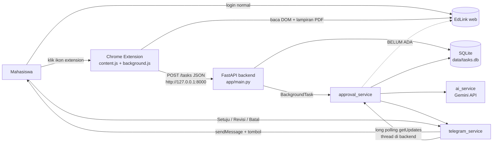

# PROJECT_GUIDE — EdLink AI Agent

> Dokumen orientasi dan audit teknis. Disusun pada 2026-10-16 dari inspeksi kode di commit `e60a9dc` (branch `main`, working tree bersih saat audit).
> Sumber kebenaran adalah **kode aktual**, bukan rencana. Status fitur memakai: **Implemented**, **Partially Implemented**, **Not Implemented**, **Blocked**, **Unverified**, **Broken**.
> Tidak ada secret yang dibaca atau dicantumkan. Tidak ada kode aplikasi yang diubah.

---

## 1. Project Overview

**Nama:** EdLink AI Agent (FastAPI `title="EdLink AI Agent"`, `version="0.3.0"`; extension "EdLink Assistant (dev)" `0.0.3`).

**Masalah:** mahasiswa harus membuka EdLink, membaca instruksi tugas, mengerjakan, lalu mengumpulkan secara manual, dan mudah terlewat.

**Tujuan produk (rencana):** mendeteksi tugas di EdLink, menyimpannya tanpa duplikat, membuat draf jawaban dengan AI, mengirim notifikasi ke aplikasi pesan, meminta persetujuan pengguna, lalu membantu pengisian dan pengumpulan.

**Yang benar-benar ada saat ini:** pipeline *deteksi → simpan → dedup → draf AI → notifikasi Telegram → setuju/revisi/batal*. Tahap **pengisian jawaban dan pengumpulan ke EdLink belum ada**. Status `approved` hanya penanda internal; kode sendiri menyatakan "Pengiriman ke EdLink BELUM ada" (`approval_service.py`, docstring modul).

**Target pengguna:** satu mahasiswa (single-user, satu chat Telegram yang diizinkan, backend lokal).

**Ruang lingkup MVP (disimpulkan dari kode):** extension Chrome membaca satu halaman tugas → backend lokal → Gemini → Telegram. Pengguna tetap mengumpulkan tugas secara manual.

**Di luar cakupan saat ini (disimpulkan, belum dikonfirmasi pemilik):** multi-user, autentikasi API, OCR untuk PDF hasil scan, lampiran non-PDF, pengumpulan otomatis, WhatsApp.

---

## 2. Product Workflow

| # | Langkah | Status | Catatan / bukti |
|---|---------|--------|-----------------|
| 1 | Pengguna login ke EdLink secara normal | Implemented (di luar sistem) | Extension hanya berjalan di `https://edlink.id/panel/classes/*`; tidak menyimpan credential. |
| 2 | Deteksi tugas | Partially Implemented / Unverified | Manual: pengguna klik ikon extension (`background.js` `action.onClicked`). Tidak ada pemindaian otomatis seluruh daftar tugas. Selector DOM (`div.post-box`, `p.font-20.font-w-600`, label "Batas tanggal"/"Deskripsi") **belum diverifikasi** terhadap EdLink asli. |
| 3 | Validasi & simpan | Implemented (diuji lokal) | `POST /tasks` (`main.py`), validasi Pydantic, tabel `tasks`. |
| 4 | Deteksi duplikasi | Implemented (diuji lokal) | `source_key = sha256(url_tanpa_query + "\|" + judul.casefold())`, kolom `UNIQUE`. |
| 5 | Draf AI | Implemented kode; **Unverified** terhadap Gemini asli | `ai_service.generate_draft`. Diuji hanya dengan pengganti (mock). |
| 6 | Notifikasi Telegram | Implemented kode; **Unverified** terhadap Telegram asli | `telegram_service`, `approval_service.notify_new_task`. |
| 7 | Tinjau: setuju / revisi / batal | Implemented (state machine diuji dengan mock) | `approval_service.handle_callback`, `handle_message`. |
| 8 | Pengisian / pengumpulan ke EdLink | **Not Implemented** | Tidak ada kode yang menulis ke EdLink. |
| 9 | Pembaruan status akhir | Partially Implemented | Status berhenti di `approved`/`cancelled`; tidak ada `submitted`/`failed`. |

---

## 3. Technology Stack

Versi dependency **tidak dipin** (`backend/requirements.txt` hanya nama paket). Versi di kolom kanan adalah hasil `pip install` pada saat audit (Python 3.13.16), bukan jaminan dari repo.

| Teknologi | Peran | Versi terpasang saat audit |
|-----------|-------|----------------------------|
| Python | Runtime backend | 3.13.16 (versi minimum yang didukung: tidak didokumentasikan) |
| FastAPI | REST API | 0.143.2 |
| Uvicorn (`[standard]`) | Server ASGI | 0.54.0 |
| Pydantic / Starlette | Validasi / dasar FastAPI (transitif) | 2.14.1 / 1.8.0 |
| httpx | Klien HTTP ke Gemini dan Telegram | 0.28.1 |
| python-dotenv | Memuat `backend/.env` | 1.2.4 |
| pypdf | Ekstraksi teks PDF lampiran | 6.20.1 |
| SQLite (`sqlite3` stdlib) | Penyimpanan di `data/tasks.db` | bawaan Python |
| Gemini Interactions API (`generativelanguage.googleapis.com/v1beta/interactions`) | Generasi draf | layanan eksternal; format respons **Unverified** |
| Telegram Bot API (long polling) | Notifikasi & persetujuan | layanan eksternal |
| Chrome Extension Manifest V3 | Pengambilan data halaman EdLink | `manifest_version: 3` |
| `google-genai` | Hanya dipakai `backend/list_models.py` | **tidak ada di `requirements.txt`** (impor gagal saat diuji) |

Tidak ditemukan: ORM, migration tool, test framework, Dockerfile, CI, linter.

---

## 4. Architecture



**Alur request → response (tugas baru):**
1. Klik ikon extension → `content.js` mengekstrak judul, batas, deskripsi, URL (tanpa query), dan mengunduh lampiran PDF (maks. 3).
2. `background.js` mengirim `POST /tasks`. Backend mengekstrak teks PDF (hanya teks yang disimpan, file tidak), menghitung `source_key`, lalu `INSERT` atau mengembalikan `created:false`.
3. Setelah respons dikirim, `BackgroundTasks` menjalankan `approval_service.notify_new_task`: kirim ringkasan ke Telegram, lalu `start_draft` → `generate_draft` → simpan draf, status `draft_ready`, kirim draf beserta tombol.
4. Tombol/pesan Telegram diterima oleh thread polling di proses backend yang sama, lalu diteruskan ke `handle_callback` / `handle_message`.

**Batas tanggung jawab modul**

| Modul | Tanggung jawab |
|-------|----------------|
| `extension/content.js` | Scraping DOM halaman tugas, unduh lampiran |
| `extension/background.js` | Orkestrasi, tangkap unduhan berbasis klik, kirim ke backend, badge status |
| `app/main.py` | Endpoint HTTP, validasi, dedup, penyimpanan |
| `app/attachment_service.py` | Base64 → PDF → teks |
| `app/ai_service.py` | Prompt, retry, fallback model, parsing respons Gemini |
| `app/telegram_service.py` | Klien Telegram, polling, filter chat ID |
| `app/approval_service.py` | State machine persetujuan |
| `app/task_service.py` | Akses data tugas dan `bot_state` |
| `app/database.py` | Koneksi dan skema SQLite |

**Masih rencana / kosong:** `app/whatsapp_service.py`, `app/edlink_service.py`, `app/models.py`, `extension/popup.html` (semuanya file **0 byte**); semua yang berkaitan dengan pengisian/pengumpulan ke EdLink.

---

## 5. Repository Structure

```
backend/
  requirements.txt        dependency (tanpa versi)
  .env.example            template env (TIDAK sesuai kode, lihat §9 M-1)
  list_models.py          skrip utilitas daftar model Gemini (butuh google-genai)
  app/
    main.py               entry point FastAPI, 4 endpoint
    database.py           koneksi SQLite + init_db + migrasi kolom
    task_service.py       CRUD tugas dan bot_state
    approval_service.py   alur notifikasi → draf → persetujuan
    telegram_service.py   klien Telegram + polling + otorisasi chat
    ai_service.py         panggilan Gemini
    attachment_service.py ekstraksi teks PDF
    whatsapp_service.py   KOSONG (0 byte)
    edlink_service.py     KOSONG (0 byte)
    models.py             KOSONG (0 byte)
extension/
  manifest.json           MV3, permission `scripting`
  content.js              scraping halaman + unduh lampiran
  background.js           klik ikon, tangkap unduhan, POST ke backend
  popup.html              KOSONG, tidak direferensikan manifest
data/                     hanya .gitkeep; tasks.db dibuat saat runtime (di-ignore git)
README.md                 KOSONG (0 byte)
```

Tidak ada direktori `tests/`.

---

## 6. Database and Data Flow

Database: SQLite, file `data/tasks.db` (`database.DB_PATH`). Skema dibuat oleh `init_db()` saat startup; kolom baru ditambahkan lewat `_ensure_column` (migrasi aditif sederhana, tanpa versi).

**Tabel `tasks`**

| Kolom | Tipe / constraint | Kegunaan |
|-------|-------------------|----------|
| `id` | INTEGER PK AUTOINCREMENT | ID tugas |
| `source_key` | TEXT NOT NULL **UNIQUE** | Kunci dedup (SHA-256) |
| `title` | TEXT NOT NULL | Judul |
| `description` | TEXT DEFAULT '' | Instruksi |
| `due_text` | TEXT DEFAULT '' | Batas waktu **sebagai teks mentah** (tidak diparse) |
| `url` | TEXT NOT NULL | URL tanpa query/fragment |
| `status` | TEXT NOT NULL DEFAULT 'detected' | Status (lihat bawah); **tanpa CHECK constraint** |
| `draft` | TEXT DEFAULT '' | Draf terakhir |
| `created_at` | TEXT NOT NULL DEFAULT CURRENT_TIMESTAMP | Waktu dibuat (UTC) |
| `attachment_text` | TEXT DEFAULT '' (migrasi) | Teks hasil ekstraksi PDF |
| `attachment_info` | TEXT DEFAULT '' (migrasi) | Ringkasan status lampiran |

**Tabel `bot_state`**: `key TEXT PK`, `value TEXT NOT NULL`. Dipakai satu kunci: `awaiting_revision` (berisi `task_id`).

Tidak ada relasi/foreign key. Tidak ada kolom `updated_at`, `submitted_at`, atau riwayat draf.

**Deduplikasi:** `sha256(f"{url}|{title.casefold()}")`, dengan `url` sudah dibersihkan dari query/fragment dan `title` sudah di-`strip`. Diuji: duplikat persis, beda huruf besar/kecil, spasi tepi, dan beda query → semuanya terdeteksi duplikat. Judul berubah → dianggap tugas baru.

**Status tugas (kode aktual):**

```
detected ──(draf dibuat)──► draft_ready ──(Setuju)──► approved
    │                           │  ▲
    │                           │  └─(Revisi → draf baru)
    └──────────(Batal)──────────┴──(Batal)──► cancelled
```
`awaiting_revision` bukan status tugas; itu entri `bot_state`. Dari `approved` tidak ada transisi lanjut. Transisi dijaga di `approval_service.handle_callback`, **tetapi tidak di `POST /tasks/{id}/draft`** (lihat H-1).

**Membuat / membaca / memperbarui:** `INSERT` di `create_task`; `UPDATE` lampiran bila tugas lama ternyata baru punya teks lampiran; `UPDATE draft,status` lewat `task_service.save_draft` dan endpoint `/draft`; `UPDATE status` lewat `set_status`.

**Risiko inkonsistensi:** lihat H-1, M-4, M-5.

---

## 7. API Reference

Semua endpoint **tanpa autentikasi**. Tidak ada CORS middleware. Dokumentasi interaktif otomatis di `/docs` (HTTP 200 saat diuji).

| Method & path | Fungsi | Request | Response / status | Verifikasi |
|---------------|--------|---------|-------------------|------------|
| `GET /health` | Cek hidup | – | `200 {"status":"ok","service":"edlink-ai-agent"}` | Diuji ✔ |
| `POST /tasks` | Simpan tugas, dedup, picu notifikasi+draf (background) | `title` (1–300), `description` (≤12000), `due_text` (≤300), `url` (HttpUrl), `attachments` (≤5; `name`≤300, `content_base64`≤21 jt karakter) | `200` `{created:true, task_id, status:"detected", attachment_info}` atau `{created:false, task_id, attachment_updated, ...}`; `422` bila validasi gagal | Diuji ✔ (baru, duplikat, 422, PDF, non-PDF, base64 rusak) |
| `GET /tasks` | Daftar tugas (id DESC) | – | `200` list `{id,title,description,due_text,url,status,attachment_info,created_at}` (tanpa `draft` dan `attachment_text`) | Diuji ✔ |
| `POST /tasks/{task_id}/draft` | Buat draf sinkron lewat Gemini | path `task_id` | `200 {task_id,status:"draft_ready",draft}`; `404` tugas tak ada; `429` kuota; `502` kegagalan lain | `404`, `502` (tanpa key), `200` (mock) diuji; Gemini asli **tidak** diuji |

Dependency: `/draft` memerlukan `GEMINI_API_KEY` dan `GEMINI_MODEL`. Panggilan sinkron bisa menahan worker hingga ±45 detik (`TOTAL_BUDGET`).

---

## 8. Feature Status and Audit Results

| Fitur | Status | Bukti Implementasi | Hasil Verifikasi | Kekurangan |
|-------|--------|--------------------|------------------|------------|
| Backend & API | Implemented | `main.py`; 4 endpoint | Server dijalankan lokal; `/health`, `/docs`, `/openapi.json` OK | Tanpa auth; `on_event` deprecated |
| Penyimpanan DB | Implemented | `database.py`, `task_service.py` | Insert/select/update diuji pada DB sementara | Koneksi tidak ditutup (M-3); tanpa CHECK status |
| Pengambilan data EdLink | Partially Implemented / Unverified | `content.js`, `background.js` | **Tidak diuji** (butuh login EdLink asli & Chrome) | Selector rapuh; hanya halaman tugas tunggal, manual via klik |
| Deduplikasi | Implemented | `main.create_task`, `UNIQUE source_key` | 4 skenario lulus | Judul berubah = tugas baru; race belum diuji (M-5) |
| Draf AI | Implemented kode / Unverified | `ai_service.generate_draft` | Hanya jalur error & mock | Format respons `steps/model_output` belum diverifikasi ke dokumentasi Gemini |
| Lampiran PDF | Implemented (teks saja) | `attachment_service.py` | PDF teks valid terbaca; non-PDF dan base64 rusak ditangani | Tanpa OCR; maks 3 file, 15 MB, 60 halaman, 30.000 karakter |
| Integrasi Telegram | Implemented kode / Unverified | `telegram_service.py` | Otorisasi chat ID diuji dengan mock | Tidak diuji ke Telegram asli |
| Persetujuan pengguna | Implemented (mock) | `approval_service.py` | 18 skenario transisi lulus | Satu `awaiting_revision` global; bypass via `/draft` (H-1) |
| Pengisian jawaban | **Not Implemented** | `edlink_service.py` kosong | – | – |
| Pengumpulan tugas | **Not Implemented** | tidak ada kode | – | Pesan "Setuju" menyatakan hal ini secara eksplisit |
| Pembaruan status | Partially Implemented | `set_status`, `save_draft` | Diuji | Tidak ada status `submitted`/`failed` |
| Logging & error handling | Partially Implemented | `print("DEBUG: ...")` | – | Tanpa modul `logging` terstruktur; level tidak dapat diatur |
| Security | Partially Implemented | allowlist chat ID, URL dibersihkan, `.env` di-ignore | Allowlist diuji | Lihat §10 |
| Automated tests | **Not Implemented** | tidak ada `tests/`, tidak ada pytest | – | – |
| Integrasi end-to-end | **Unverified** | – | Tidak mungkin dijalankan tanpa EdLink, Gemini, Telegram nyata | – |
| WhatsApp | **Not Implemented** | `whatsapp_service.py` kosong; hanya variabel di `.env.example` | – | – |

---

## 9. Bugs, Risks, and Technical Debt

Tidak ada temuan **Critical** yang terkonfirmasi.

### High

**H-1. `POST /tasks/{id}/draft` mengabaikan status dan menimpa `approved`/`cancelled`** — *terkonfirmasi*
- Lokasi: `main.py` `create_task_draft` (UPDATE `status='draft_ready'` tanpa pengecekan status sebelumnya).
- Dampak: tugas yang sudah disetujui atau dibatalkan kembali menjadi `draft_ready` dan draf lama tertimpa. Ini melemahkan jaminan "persetujuan eksplisit"; begitu pengumpulan otomatis dibuat, status bisa berpindah mundur tanpa sepengetahuan pengguna.
- Reproduksi (diuji): set status `approved`, panggil endpoint → status akhir `draft_ready`; sama untuk `cancelled`.
- Rekomendasi: tolak (409) bila status `approved`/`cancelled`, atau arahkan endpoint lewat logika yang sama dengan `approval_service`. Pertimbangkan menghapus endpoint ini bila tidak dipakai (extension tidak memanggilnya).

**H-2. API tanpa autentikasi** — *terkonfirmasi (sifat desain)*
- Lokasi: seluruh `main.py`.
- Dampak: bila backend dijalankan dengan `--host 0.0.0.0` atau diekspos, siapa pun dapat membaca `GET /tasks`, membuat tugas, dan memicu panggilan Gemini berbayar lewat `/draft`. Pada `127.0.0.1`, proses lokal lain tetap bisa mengaksesnya.
- Rekomendasi: token statis sederhana di header untuk extension, dan dokumentasikan agar selalu bind ke `127.0.0.1`.

### Medium

**M-1. `.env.example` tidak sesuai kode** — *terkonfirmasi*
- `backend/.env.example` berisi `OPENAI_*` dan `WHATSAPP_*`; kode membaca `GEMINI_API_KEY`, `GEMINI_MODEL`, `GEMINI_FALLBACK_MODELS`, `TELEGRAM_BOT_TOKEN`, `TELEGRAM_ALLOWED_CHAT_ID`. Developer baru yang mengikuti template akan mendapati AI dan Telegram nonaktif tanpa petunjuk jelas.

**M-2. Format respons Gemini belum terverifikasi** — *Unverified*
- `ai_service.py` membaca `data["steps"][*].type == "model_output"` dan `content[*].type == "text"`. Saya tidak sempat memverifikasinya terhadap dokumentasi resmi (pemeriksaan terhenti karena batas sesi). Kodenya sendiri berkomentar "Format respons belum terverifikasi". Bila salah, semua draf gagal dengan "Gemini tidak menghasilkan teks jawaban".

**M-3. Koneksi SQLite tidak ditutup** — *terkonfirmasi*
- `database.get_connection()` dipakai dengan `with conn:`, yang hanya commit/rollback, tidak menutup. Pada pengujian muncul 10–12 `ResourceWarning: unclosed database`. Dampak kecil untuk satu pengguna, tetapi berisiko kebocoran file handle pada proses panjang. Rekomendasi: `contextlib.closing` atau context manager sendiri.

**M-4. Satu state revisi global** — *terbaca dari kode, perilaku multi-tugas belum diuji*
- `bot_state['awaiting_revision']` hanya menyimpan satu `task_id`. Menekan "Revisi" pada tugas B menimpa permintaan revisi tugas A yang belum dijawab.

**M-5. Dedup `SELECT` lalu `INSERT` tanpa penanganan `IntegrityError`** — *dugaan, belum diuji*
- Dua request bersamaan untuk tugas baru yang sama bisa lolos `SELECT`, lalu salah satu gagal pada `UNIQUE` dan menjadi HTTP 500. Constraint menjaga data tetap benar; yang terganggu hanya responsnya.

**M-6. Selector EdLink rapuh dan belum diverifikasi** — *Unverified*
- `content.js`: `div.post-box`, `p.font-20.font-w-600`, label teks "Batas tanggal", "Deskripsi", "Lampiran", "Anggota", `.post-attachment-item`. Perubahan UI EdLink akan memutus pengambilan data secara diam-diam (badge `?`).

**M-7. Tidak ada test otomatis dan README kosong** — *terkonfirmasi*

### Low

- **L-1.** Logging memakai `print("DEBUG: ...")`; tidak ada level, rotasi, atau format.
- **L-2.** `@app.on_event` deprecated di FastAPI (peringatan muncul saat uji); ganti dengan `lifespan`.
- **L-3.** Dependency tidak dipin; `google-genai` dipakai `list_models.py` tetapi tidak ada di `requirements.txt` (impor gagal).
- **L-4.** `start_draft` mengirim `f"Gagal membuat draf: {e}"` ke Telegram; pesan error mentah bisa bocor detail internal. Saat ini pesan yang dihasilkan kode tampak aman, tetapi pola ini rawan.
- **L-5.** File kosong (`models.py`, `edlink_service.py`, `whatsapp_service.py`, `popup.html`) menyesatkan karena tampak seperti modul yang ada.
- **L-6.** `due_text` disimpan sebagai teks bebas; tidak bisa dipakai untuk pengingat atau pengurutan tenggat.
- **L-7.** Riwayat git: 6 commit, hampir semua berpesan "initial commit"; sulit ditelusuri.
- **L-8.** Menurut kode, `uvicorn --reload` dapat menjalankan dua polling Telegram dan memicu error 409 (dikomentari di `telegram_service._poll_loop`); belum direproduksi.

---

## 10. Security and Privacy

| Area | Temuan | Status |
|------|--------|--------|
| Secret & `.env` | Dimuat dari `backend/.env`; `.env` dan `*.db` ada di `.gitignore`. Pemindaian pola kunci API/token pada seluruh riwayat git yang terlihat (6 commit): **0 kecocokan**; `.env` dan `*.db` tidak pernah dilacak. | Baik |
| Kunci Gemini | Dikirim lewat header `x-goog-api-key`, bukan URL. | Baik |
| Token Telegram | Berada di URL (cara standar Telegram); logger `httpx` diturunkan ke WARNING agar tidak tercetak. | Baik; tidak dites penuh |
| Otorisasi Telegram | Pesan dan callback dari chat selain `TELEGRAM_ALLOWED_CHAT_ID` diabaikan. Saat ID belum diisi, bot hanya membalas `/start` dengan chat ID pengirim, dan tidak memproses perintah lain. Diuji dengan mock. | Baik |
| Autentikasi API | Tidak ada (H-2). | Risiko |
| Kanal extension → backend | HTTP polos ke `127.0.0.1:8000` (aman untuk loopback), tanpa token. Tanpa CORS middleware sehingga halaman web lain tidak dapat membaca respons; apakah POST lintas-origin dapat diblokir sepenuhnya belum diuji. | Unverified |
| Credential/session EdLink | Tidak disimpan oleh sistem. Extension membaca halaman yang sudah dibuka pengguna dan memakai sesi browser pengguna. | Baik |
| URL | `clean_url` membuang query/fragment (mencegah token di URL tersimpan). Backend menerima domain apa pun, tidak dibatasi ke `edlink.id` (diuji). | Catatan |
| Lampiran | Hanya teks yang disimpan; ukuran dan jumlah dibatasi. `pypdf` memproses PDF dari input tak tepercaya; parser PDF punya riwayat kerentanan, jaga versi tetap baru. | Catatan |
| Prompt injection | Teks tugas dan PDF masuk ke prompt; prompt memberi instruksi agar lampiran diperlakukan sebagai bahan, bukan perintah. Keluaran hanya dikirim ke pengguna untuk ditinjau, tanpa tool call. Risiko rendah selama tidak ada aksi otomatis. | Catatan |
| Injection SQL | Semua query memakai parameter `?`; satu f-string pada `PRAGMA table_info({table})` hanya menerima konstanta internal. | Baik |
| Data sensitif di log | `print` mencatat nama lampiran, status, dan 300 karakter pertama body error Gemini. Isi tugas tidak dicetak. | Catatan |
| Persetujuan sebelum aksi eksternal | Ada tombol Setuju/Revisi/Batal dan tombol dihapus setelah ditekan. Namun belum ada aksi eksternal untuk dilindungi, dan H-1 bisa mengacaukan status. | Parsial |
| Risiko pengiriman tidak sengaja | Saat ini nol karena pengumpulan belum ada. Harus dirancang ulang sebelum fitur itu dibuat. | – |
| Extension: pola kode | `captureByClick` menjalankan skrip di `world: MAIN` yang menimpa sementara `fetch`, `XMLHttpRequest`, `window.open`, dan `URL.createObjectURL` pada halaman EdLink untuk menangkap unduhan, lalu memulihkannya di `finally`. Ini berjalan di sesi pengguna sendiri, tetapi invasif dan rapuh; tinjau ulang bila ingin dipublikasikan. | Perlu kehati-hatian |

Panduan: jangan menambah fitur yang menyalin sesi/cookie, menyamar sebagai pengguna, atau memakai endpoint privat EdLink tanpa izin. Gunakan jalur resmi (API/integrasi yang diizinkan EdLink) atau biarkan pengguna mengumpulkan sendiri.

---

## 11. Setup and Runbook

**Status:** tidak ada dokumentasi setup di repo (README kosong). Langkah berikut dirangkai dari berkas aktual. Yang ditandai ✔ sudah dijalankan saat audit pada salinan repo; ⚠ belum diuji.

**Prasyarat:** Python 3 (diuji 3.13.16), Chrome/Chromium untuk extension, bot Telegram (token dari BotFather), kunci API Gemini. ⚠ versi Python minimum belum ditetapkan.

```bash
cd backend
python3 -m venv .venv                 # ✔
source .venv/bin/activate             # Windows: .venv\Scripts\activate   (⚠ belum diuji di Windows)
pip install -r requirements.txt       # ✔
```

**Konfigurasi** — buat `backend/.env` (jangan di-commit). Gunakan nama variabel yang benar-benar dibaca kode, bukan isi `.env.example`:

```env
GEMINI_API_KEY=isi_dengan_kunci_anda
GEMINI_MODEL=nama_model_yang_tersedia_untuk_kunci_anda
GEMINI_FALLBACK_MODELS=            # opsional, dipisah koma
TELEGRAM_BOT_TOKEN=isi_dengan_token_bot
TELEGRAM_ALLOWED_CHAT_ID=          # isi setelah mengirim /start ke bot
```

Alur chat ID: jalankan backend tanpa `TELEGRAM_ALLOWED_CHAT_ID`, kirim `/start` ke bot, salin ID yang dibalas, isi ke `.env`, restart. (diturunkan dari kode, ⚠ belum diuji dengan Telegram asli)

**Menjalankan backend** (dari folder `backend/`, karena impor memakai `from app import ...`):

```bash
uvicorn app.main:app --host 127.0.0.1 --port 8000     # ✔ (tanpa token: Telegram nonaktif, server tetap naik)
```
Extension mengharapkan alamat `http://127.0.0.1:8000` (`background.js` `BACKEND`). Hindari `--reload` selama Telegram aktif (L-8).

**Dokumentasi API:** `http://127.0.0.1:8000/docs` ✔ (HTTP 200).

**Cek kesehatan:** `curl http://127.0.0.1:8000/health` ✔ → `{"status":"ok","service":"edlink-ai-agent"}`.

**Memasang extension:** Chrome → `chrome://extensions` → Developer mode → *Load unpacked* → pilih folder `extension/`. Buka halaman tugas di `https://edlink.id/panel/classes/...`, klik ikon extension; badge `OK` (baru), `=` (sudah ada), `?` (tugas tak terbaca), `ERR` (gagal). ⚠ belum diuji.

**Menjalankan test:** repo tidak memiliki test. ⚠ Tidak ada perintah yang dapat dicantumkan.

**Daftar model Gemini:** `python list_models.py` ⚠ memerlukan `pip install google-genai` (tidak ada di requirements) dan memanggil layanan eksternal.

**Masalah umum (dari kode, belum direproduksi):**

| Gejala | Kemungkinan penyebab |
|--------|---------------------|
| Tidak ada notifikasi Telegram | `TELEGRAM_BOT_TOKEN` atau `TELEGRAM_ALLOWED_CHAT_ID` kosong; log: "Telegram belum dikonfigurasi lengkap" |
| `POST /draft` → 502 | `GEMINI_API_KEY`/`GEMINI_MODEL` kosong, atau respons Gemini tak terbaca (lihat terminal) |
| `POST /draft` → 429 | Kuota Gemini habis |
| Error 409 pada log polling | Dua proses backend polling bersamaan |
| Lampiran "tidak ada teks" | PDF hasil scan (tanpa OCR) |
| Badge `?` di extension | Halaman belum selesai dirender atau struktur DOM EdLink berubah |

---

## 12. Current Project State

- **Commit terakhir:** `e60a9dc` ("initial commit", 2026-10-15), branch `main`. Riwayat yang terlihat: 6 commit sejak 2026-10-14. Tidak ada perubahan lokal yang belum di-commit saat audit (sebelum `PROJECT_GUIDE.md` ditambahkan).
- **Selesai (kode ada):** API dasar, penyimpanan, dedup, ekstraksi PDF, klien Gemini, klien Telegram, state machine persetujuan, extension pengambil tugas.
- **Terbukti bekerja lewat pengujian lokal:** health/docs, validasi input, dedup, penyimpanan lampiran PDF teks, state machine persetujuan, filter chat ID Telegram (semuanya tanpa layanan eksternal).
- **Ada tetapi belum terverifikasi:** scraping EdLink asli, pemanggilan Gemini asli, pengiriman/penerimaan Telegram asli, penangkapan unduhan berbasis klik, format respons Gemini.
- **Bermasalah:** H-1, M-1.
- **Belum dibuat:** pengisian dan pengumpulan, WhatsApp, test otomatis, autentikasi API, OCR, dokumentasi.
- **Hambatan utama:** verifikasi end-to-end butuh akun EdLink, kunci Gemini, dan bot Telegram yang nyata.
- **Apakah MVP bisa dipakai end-to-end?** Untuk bagian *deteksi → draf → persetujuan* kemungkinan besar bisa, **belum terbukti**. Untuk tujuan produk penuh (pengumpulan), **belum**.

---

## 13. Recommended Next Steps

*Roadmap, belum diimplementasikan.*

**P0 — integritas & keamanan**
1. **Kunci transisi status di `/tasks/{id}/draft`** (H-1). Berkas: `main.py`, `task_service.py`. Selesai bila `approved`/`cancelled` tidak bisa kembali ke `draft_ready` lewat API. Uji: test otomatis untuk tiap status awal.
2. **Autentikasi sederhana + bind loopback terdokumentasi** (H-2). Berkas: `main.py`, `background.js`, `.env`. Selesai bila request tanpa token ditolak 401 dan extension tetap bekerja. Uji: curl tanpa/dengan token.

**P1 — inti MVP**
3. **Perbaiki `.env.example`, `requirements.txt` (pin versi, tambah `google-genai` bila `list_models.py` dipertahankan), dan isi README** (M-1, L-3, M-7). Selesai bila developer baru dapat menjalankan backend hanya dari README.
4. **Verifikasi format respons Gemini** (M-2) dengan satu panggilan nyata berbiaya kecil atas izin pemilik; sesuaikan parser bila perlu.
5. **Tutup koneksi SQLite, tangani `IntegrityError` pada dedup** (M-3, M-5).

**P2 — pengujian & integrasi**
6. **Tambah pytest** berdasarkan skenario yang sudah terbukti pada audit ini (dedup, validasi, lampiran, state machine, otorisasi chat), dengan mock Gemini/Telegram.
7. **Uji end-to-end manual** di EdLink asli: ekstraksi, lampiran, notifikasi, revisi, persetujuan; catat hasilnya. Verifikasi selector (M-6).
8. **Perbaiki state revisi per tugas** (M-4).

**P3 — kualitas & fitur lanjutan**
9. Ganti `print` dengan `logging`; ganti `on_event` dengan `lifespan` (L-1, L-2).
10. Rancang mekanisme pengumpulan **hanya lewat jalur resmi/diizinkan**, dengan konfirmasi eksplisit per tugas dan status `submitted`/`failed`. Sebelum itu, konfirmasi ke pemilik apakah EdLink menyediakan API atau integrasi resmi.
11. Parse `due_text` menjadi tanggal; pengingat tenggat; OCR bila PDF scan umum.

---

## 14. Developer Handover

**Baca dulu (urutan):** `backend/app/main.py` → `approval_service.py` (docstring + `handle_callback`) → `telegram_service.py` (`_dispatch`) → `ai_service.py` → `extension/content.js` → `extension/background.js`.

**Menjalankan:** ikuti §11. Mulai tanpa token Telegram/Gemini untuk memastikan server naik, lalu aktifkan layanan satu per satu.

**Memahami alur utama:** `POST /tasks` → `BackgroundTasks` → `notify_new_task` → `start_draft` → `generate_draft` → pesan Telegram bertombol → `handle_callback` → `set_status`.

**Aman dikembangkan:** `attachment_service.py` (modul murni, mudah diuji), `task_service.py`, validasi di `main.py`, prompt di `ai_service.py`, dokumentasi, test.

**Perlu kehati-hatian:** `extension/background.js` `captureByClick` (menimpa API halaman); apa pun yang menyentuh pengumpulan ke EdLink; `telegram_service` polling (thread, 409); perubahan skema SQLite (belum ada sistem migrasi, hanya `_ensure_column`).

**Pekerjaan berikutnya yang paling masuk akal:** P0 lalu P1 di §13.

**Konfirmasi dulu sebelum perubahan besar:**
- Apakah EdLink menyediakan API/integrasi resmi untuk mengisi dan mengumpulkan tugas?
- Apakah WhatsApp masih direncanakan, atau cukup Telegram? (`.env.example` menunjukkan rencana WhatsApp dan OpenAI yang tidak ada di kode.)
- Apakah proyek tetap single-user lokal, atau akan dihosting (menentukan kebutuhan autentikasi dan database)?
- Apakah file kosong (`models.py`, `edlink_service.py`, `whatsapp_service.py`, `popup.html`) boleh dihapus atau dipertahankan sebagai penanda rencana?

---

### Lampiran: cara audit ini dilakukan

- Seluruh 14 berkas kode non-kosong dibaca penuh.
- Backend disalin ke folder sementara (di luar repo), dependency dipasang di venv terpisah, lalu dijalankan: 41 pemeriksaan otomatis (FastAPI `TestClient`, database sementara, Gemini dan Telegram diganti pengganti lokal) → **41/41 sesuai ekspektasi** setelah PDF uji diperbaiki (kegagalan awal berasal dari PDF uji buatan saya yang tidak valid, bukan dari kode proyek). Server juga dijalankan dengan `uvicorn` dan `/health`, `/docs`, `/openapi.json` diakses.
- Skrip uji **tidak** disertakan di repo (sengaja, agar tidak menambah file).
- Tidak ada panggilan ke Gemini, Telegram, atau EdLink. Tidak diuji: extension di Chrome, pemanggilan layanan asli, end-to-end.
